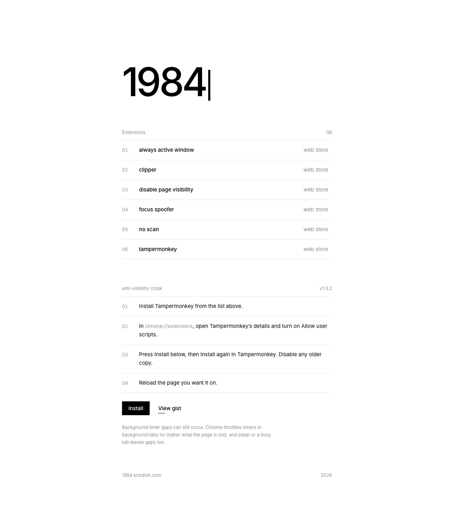

# 1984

A one-page list of browser extensions that keep pages reporting visible and focused, plus a one-click install for the Anti-Visibility Cloak userscript.

**Live:** https://1984.knhdixh.com



## What's on the page

| | |
|---|---|
| Extensions | Always Active Window, Clipper, Disable Page Visibility, Focus Spoofer, NO SCAN, Tampermonkey, each linked to its Chrome Web Store listing |
| Userscript | [Anti-Visibility Cloak (local repair)](https://gist.github.com/knhdixh/d48dbae23d7a6f25bff6f194a2ce1057), with an Install button pointing at the Gist's raw `.user.js` URL (Tampermonkey picks it up) and a link to view the Gist |
| Setup | Four Tampermonkey steps, including turning on **Allow user scripts** in `chrome://extensions` |

The Install link uses the Gist's latest raw URL, so editing the Gist updates what new installs get without redeploying the site.

## Limitations

Background timer gaps can still occur: Chrome throttles timers in background tabs regardless of what the page's visibility APIs report, and sleep or a busy main thread also leaves gaps. The script doesn't fake elapsed time.

## Stack

A static page (`public/`) served by a plain-JS Cloudflare Worker (`src/worker.js`) that redirects `*.workers.dev` to the custom domain. No build step. Styled after the knhdixh house style (Inter, black on white, WebGL water cursor trail).

## Run locally

```bash
npm install
npm test
npx wrangler dev --port 8787 --local-upstream localhost:8787
```

## Deploy your own

```bash
npx wrangler login
npm run deploy
```

Change or remove `routes` and `vars.CANONICAL_HOST` in `wrangler.jsonc` to use your own domain. No secrets are required.

## Credits

The userscript is a repaired version of [Anti-Visibility Cloak](https://greasyfork.org/en/scripts/547317-anti-visibility-cloak) by Spinfal, GPL-3.0-or-later.
